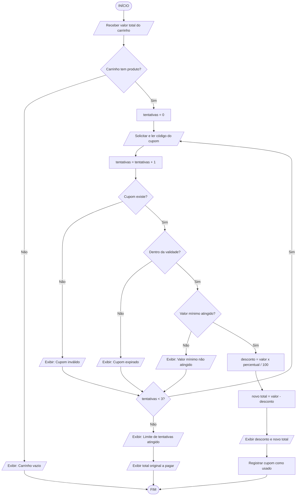

# Algoritmos & Fluxogramas: Validar um cupom de desconto em uma loja virtual

**Aluno:** Vinicius Leite
**RA:** 60015455

---

## 1. Análise do problema

| Pergunta | Resposta |
|---|---|
| **Qual é o problema ou tarefa?** | Verificar se um cupom digitado pelo cliente pode ser usado na compra e, se puder, aplicar o desconto ao total do carrinho. |
| **Qual é o objetivo?** | Mostrar ao cliente o valor do desconto e o novo total a pagar, ou informar por que o cupom não pôde ser usado. |
| **O que é necessário?** | Carrinho com ao menos um produto, valor total do carrinho, código do cupom e acesso à base de cupons (percentual, validade e valor mínimo). |
| **O que precisa ser feito?** | Ler o código, conferir se existe, conferir a validade, conferir o valor mínimo, calcular o desconto e exibir o resultado. |
| **Existem decisões?** | Sim: carrinho vazio?, cupom existe?, cupom dentro da validade?, valor mínimo atingido?, ainda há tentativas? |
| **Alguma ação se repete?** | Sim: o cliente pode digitar o cupom novamente, até 3 tentativas. |

---

## 2. Algoritmo em linguagem natural

1. Início;
2. Receber o valor total do carrinho;
3. Verificar se o carrinho possui pelo menos um produto;
4. Se o carrinho estiver vazio, exibir "Carrinho vazio" e ir para o passo 23;
5. Definir o número de tentativas como 0;
6. Solicitar que o cliente digite o código do cupom;
7. Ler o código digitado;
8. Somar 1 ao número de tentativas;
9. Verificar se o código digitado existe na base de cupons;
10. Se o código não existir, exibir "Cupom inválido" e ir para o passo 18;
11. Verificar se a data de hoje é menor ou igual à data de validade do cupom;
12. Se o cupom estiver vencido, exibir "Cupom expirado" e ir para o passo 18;
13. Verificar se o valor do carrinho é maior ou igual ao valor mínimo exigido pelo cupom;
14. Se o valor for menor que o mínimo, exibir "Valor mínimo não atingido" e ir para o passo 18;
15. Calcular o desconto: valor do carrinho × percentual do cupom ÷ 100;
16. Calcular o novo total: valor do carrinho − desconto;
17. Exibir o desconto aplicado, registrar o cupom como usado e ir para o passo 22;
18. Verificar se o número de tentativas é menor que 3;
19. Se for menor que 3, voltar para o passo 6 (repetição);
20. Se não for, exibir "Limite de tentativas atingido";
21. Manter o valor original do carrinho como total;
22. Exibir o valor final a pagar;
23. Fim.

---

## 3. Entrada, Processamento e Saída

**Entrada**
- Valor total do carrinho;
- Código do cupom digitado;
- Dados do cupom na base: percentual de desconto, data de validade e valor mínimo;
- Data atual.

**Processamento**
- Verificar se o carrinho está vazio;
- Verificar se o cupom existe;
- Comparar a data atual com a validade;
- Comparar o valor do carrinho com o valor mínimo;
- Calcular o desconto e o novo total;
- Contar as tentativas (máximo de 3).

**Saída**
- Mensagem de erro (cupom inválido, expirado, valor mínimo ou limite de tentativas); ou
- Valor do desconto aplicado e novo total a pagar.

---

## 4. Fluxograma

---

## 5. Apresentação

Na apresentação para a turma, o grupo deve:
1. Explicar a situação escolhida;
2. Ler o algoritmo passo a passo;
3. Mostrar a entrada, o processamento e a saída;
4. Percorrer o fluxograma com um exemplo (ex.: carrinho de R$ 200, cupom de 10% com mínimo de R$ 150 → desconto de R$ 20, total R$ 180).
